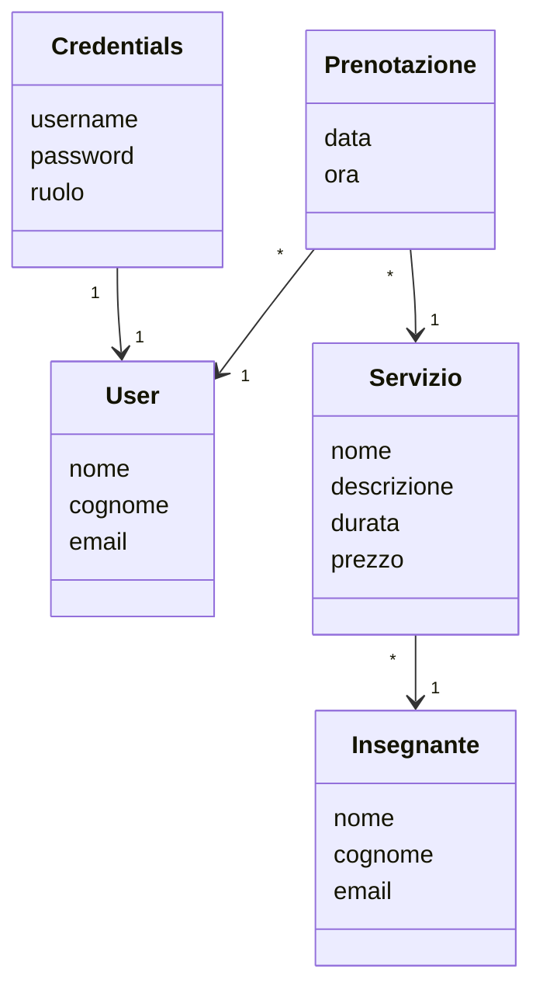

# Lezioni private: sistema di prenotazioni

Progetto personale per il corso di **Sistemi Informativi su Web** (Università Roma Tre, a.a. 2025/2026).

Sistema informativo su web per un centro di **lezioni private**. Il centro offre alcune materie (Matematica, Fisica, Informatica, Italiano…), ognuna tenuta da un insegnante. Gli utenti registrati prenotano una lezione scegliendo data e fascia oraria; il sistema controlla gli orari di apertura e che l'insegnante non abbia già un'altra lezione nello stesso momento. L'amministratore gestisce le materie e tutte le prenotazioni.

## Tecnologie

| Livello | Tecnologia |
|---|---|
| Backend | Java 27, Spring Boot 4.1 (Web MVC, Data JPA, Security, Validation) |
| Persistenza | JPA / Hibernate, PostgreSQL 18 |
| Frontend server-side | Thymeleaf (+ Thymeleaf Extras Spring Security) |
| Frontend client-side | React 19 + TypeScript (Vite), MUI, Axios |

## Casi d'uso

Registrazione, login e logout non sono contati tra i casi d'uso.

| # | Caso d'uso | Attore | Tipo |
|---|---|---|---|
| 1 | **Prenotare una lezione**: scelta di data e fascia oraria, con controllo di orari e sovrapposizioni | Utente registrato | inserimento |
| 2 | **Modificare una prenotazione** (data e ora), con gli stessi controlli | Utente registrato, admin | aggiornamento |
| 3 | **Annullare una prenotazione** | Utente registrato, admin | cancellazione |
| 4 | **Consultare le materie**: elenco e dettaglio (Thymeleaf) e catalogo con filtri (React) | Chiunque | lettura |
| 5 | **Vedere le proprie prenotazioni** | Utente registrato | lettura |
| 6 | **Gestire le materie**: inserimento, modifica (con scelta dell'insegnante) ed eliminazione | Admin | inserimento, aggiornamento, cancellazione |
| 7 | **Vedere tutte le prenotazioni** del centro, con i dati dell'utente | Admin | lettura |

## Modello di dominio



- **Servizio** è una materia: durata della lezione in minuti e prezzo.
- **Insegnante**: un insegnante può tenere più materie (es. Mario Rossi insegna Matematica e Fisica).
- **Credentials** contiene username, password (cifrata con BCrypt) e ruolo (`USER` / `ADMIN`) ed è separata da **User**, che contiene i dati anagrafici.
- L'ora di fine di una lezione non è salvata: si calcola come `ora + durata`.

## Regole di business

- **Orari**: lezioni dal lunedì al sabato, dalle 9:00 alle 19:00; la lezione deve finire entro la chiusura. Non si prenota nel passato.
- **Fasce orarie**: la form propone gli orari di inizio calcolati dalla durata della materia (60 minuti → 9:00-10:00, 10:00-11:00, …).
- **Sovrapposizioni**: un insegnante non può avere due lezioni che si sovrappongono, anche di materie diverse. Nella modifica la prenotazione stessa viene esclusa dal controllo.
- **Concorrenza**: `prenota` e `modifica` leggono le prenotazioni esistenti e poi scrivono, quindi usano `@Transactional(isolation = SERIALIZABLE)` per evitare che due utenti prenotino lo stesso slot contemporaneamente.
- **Proprietà**: un utente può modificare e annullare solo le proprie prenotazioni (controllo nel service, non solo nell'interfaccia). L'admin usa metodi dedicati, raggiungibili solo dagli URL `/admin/**`.
- **Eliminazione di una materia**: vietata se ha prenotazioni future; se ne ha solo di passate, vengono cancellate con una `DELETE` JPQL nella stessa transazione.

## Architettura

```
siw-prenotazioni/                     backend Spring Boot (porta 8080)
  src/main/java/.../siw_prenotazioni/
    model/            entità JPA
    repository/       interfacce Spring Data (query derivate e JPQL, JOIN FETCH)
    service/          logica di business e transazioni
    controller/       controller Thymeleaf, GlobalExceptionHandler
      admin/          controller dell'area admin
      rest/           API REST usata da React
    authentication/   Spring Security (AuthConfig) e CORS
    exception/        eccezioni di dominio
  src/main/resources/
    templates/        viste Thymeleaf (fragments/base.html = header comune)
    static/css/       foglio di stile
    messages/         messaggi di validazione in italiano
    import.sql        dati di prova

frontend/                             React + Vite (porta 5173)
  src/
    types/            interfacce TypeScript uguali al JSON del backend
    services/         istanza Axios e chiamate all'API
    components/       ServiziFilterGrid (griglia con filtri e ordinamento)
    pages/            HomePage
```

### API REST

| Metodo | URL | Descrizione |
|---|---|---|
| GET | `/rest/servizi` | elenco delle materie con il loro insegnante |
| GET | `/rest/servizi/{id}` | dettaglio di una materia (404 se non esiste) |

Le API sono pubbliche e in sola lettura. Il CORS è aperto solo a `http://localhost:5173`.

## Come avviare il progetto

### Prerequisiti
- JDK 27
- PostgreSQL in esecuzione su `localhost:5432`
- Node.js (LTS) per il frontend

### 1. Database
Creare un database vuoto chiamato `siwprenotazioni`. Le credenziali di accesso sono in `siw-prenotazioni/src/main/resources/application.properties` (di default `postgres` / `postgres`).

Le tabelle vengono create da Hibernate a ogni avvio (`ddl-auto=create`) e riempite con i dati di prova di `import.sql`.

### 2. Backend
```bash
cd siw-prenotazioni
./mvnw spring-boot:run
```
L'applicazione è su **http://localhost:8080**.

### 3. Frontend React
In un secondo terminale:
```bash
cd frontend
npm install
npm run dev
```
Il catalogo React è su **http://localhost:5173** (raggiungibile anche dal link "Catalogo" nell'header). Per caricare le materie deve essere acceso anche il backend.

### Utenti di prova

| Username | Ruolo |
|---|---|
| `admin` | ADMIN |
| `user1` | USER |
| `user2` | USER |

Le password sono indicate nella mail di consegna. In alternativa si può registrare un nuovo utente dalla pagina "Registrati" (ruolo `USER`).

## Malfunzionamenti noti e limitazioni

- Con `ddl-auto=create` il database viene ricreato a ogni avvio: le prenotazioni fatte si perdono al riavvio.
- Le liste delle prenotazioni caricano l'insegnante di ogni materia con una query separata (al massimo una per insegnante distinto); le liste delle materie usano invece `JOIN FETCH`.
- Le prenotazioni passate compaiono ancora con i pulsanti "Modifica" e "Annulla".
- La form di modifica di una prenotazione di un altro utente si può aprire scrivendo l'URL a mano, ma il salvataggio viene rifiutato dal controllo sul proprietario.
- La parte React è in sola lettura: la prenotazione avviene nelle pagine Thymeleaf, che gestiscono login, CSRF e validazione.
- Il link al catalogo React punta a `http://localhost:5173` (ambiente di sviluppo).
