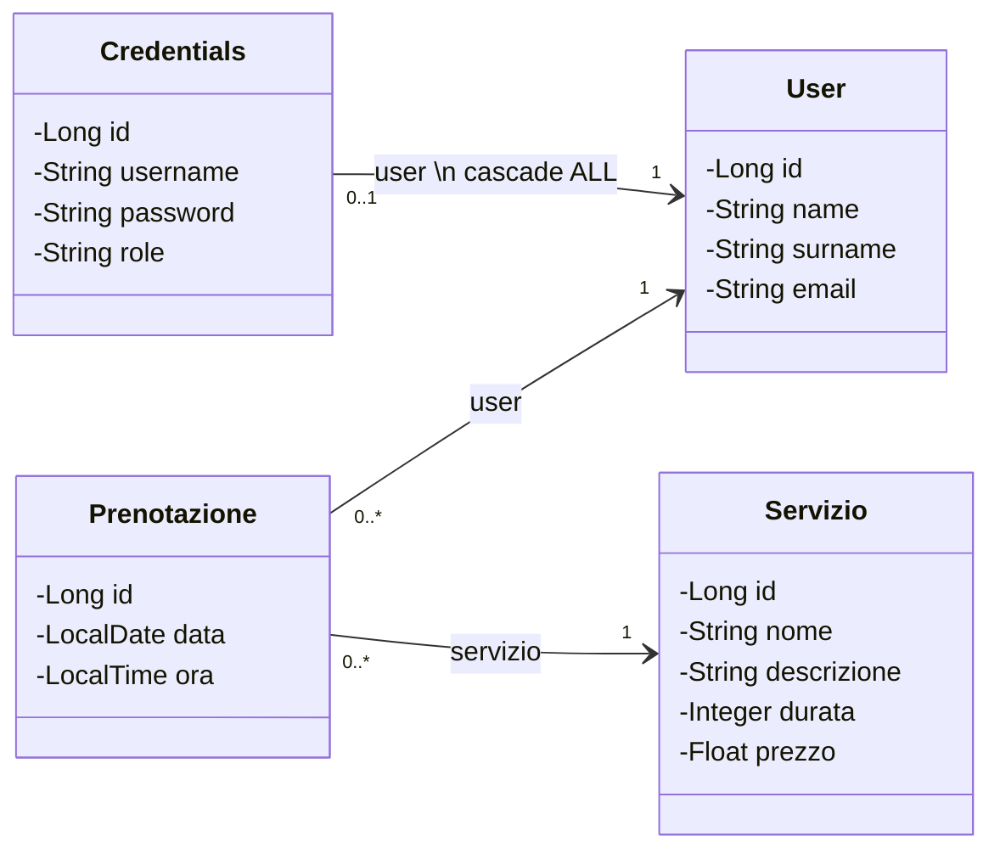

# PROGETTO PERSONALE SIW - Sistema di prenotazioni

## Scelte fatte
- Progetto: **sistema di prenotazioni mono-azienda** (scartati: negozio di scarpe, versione multi-azienda)
- Perché mono-azienda: si fa in tempi brevi, evita registrazione azienda e controlli di proprietà per admin
- Il multi-azienda si può citare all'orale come possibile estensione
- Email di conferma: solo se avanza tempo (opzionale)
- Scadenza: DA CONFERMARE (il PDF dice 13 settembre 2026, appello Settembre, ma il file si chiama "novembre")

## Requisiti dal PDF (progetto personale)
- Progettare casi d'uso e modello di dominio (con indicazioni per la persistenza)
- Almeno 6 casi d'uso: 1 inserimento, 1 aggiornamento, 1 cancellazione, 2 letture
- Autenticazione e registrazione NON contano come casi d'uso
- Stack obbligatorio: Spring Boot, JPA/Hibernate, PostgreSQL (o altro RDBMS), Thymeleaf, React (almeno una parte del frontend)
- Plus: deploy su cloud, autenticazione OAuth
- Consegna: mail a siw.roma3@gmail.com con link GitHub e malfunzionamenti noti
- Oggetto: `[Settembre 2026 PROGETTO PERSONALE] Cognome Matricola` (verificare la stringa corretta per l'appello)

## Casi d'uso
| # | Caso d'uso | Attore | Tipo |
|---|---|---|---|
| 1 | Prenotare un servizio | Utente | Inserimento |
| 2 | Modificare data/ora di una propria prenotazione | Utente | Aggiornamento |
| 3 | Annullare una propria prenotazione | Utente | Cancellazione |
| 4 | Vedere l'elenco dei servizi (e il dettaglio di un servizio) | Tutti | Lettura |
| 5 | Vedere "le mie prenotazioni" | Utente | Lettura |
| 6 | Gestire i servizi (aggiungere, modificare, eliminare) | Admin | Inserimento, aggiornamento, cancellazione |
| 7 | Vedere tutte le prenotazioni | Admin | Lettura |

Non contano come casi d'uso: registrazione, login, logout.

Il caso 1 è il più ricco: controlla sovrapposizioni e orari di apertura.

## Flusso
- Registrazione: l'utente nasce con ruolo `DEFAULT`; l'utente `ADMIN` si inserisce da `import.sql`
- Utente non registrato: vede solo l'elenco dei servizi, non può prenotare
- Utente: "Prenota" e "Le mie prenotazioni" (modifica/annulla)
	- Admin: "Gestisci servizi" e "Tutte le prenotazioni"

## Modello di dominio e logica del database
Questa sezione è la progettazione: dice **cosa** c'è e **perché**. Il codice Java lo scrivi tu a partire da qui.

Come nelle slide del prof (slide 10), utente e credenziali sono due entità separate: in `User` i dati della persona, in `Credentials` i dati per l'accesso.

### Class diagram
GitHub disegna in automatico questo blocco Mermaid: si può copiare anche nel README.



### Entità e attributi

**User** — l'utente come persona
| Attributo | Tipo | Vincoli | Note |
|---|---|---|---|
| id | Long | chiave, generato (`AUTO`) | |
| name | String | obbligatorio | |
| surname | String | obbligatorio | |
| email | String | obbligatorio, **unico** | identificatore naturale → `equals`/`hashCode` |

Tabella `users` (con `@Table(name = "users")`), perché `user` è una parola riservata in Postgres.

**Credentials** — i dati di accesso
| Attributo | Tipo | Vincoli | Note |
|---|---|---|---|
| id | Long | chiave, generato | |
| username | String | obbligatorio, **unico** | identificatore naturale |
| password | String | obbligatorio | salvata cifrata con BCrypt, mai in chiaro |
| role | String | | `DEFAULT` o `ADMIN` (costanti nella classe) |
| user | User | obbligatorio | associazione verso User |

**Servizio** — ciò che si può prenotare (es. "Taglio", "Massaggio 60 min")
| Attributo | Tipo | Vincoli | Note |
|---|---|---|---|
| id | Long | chiave, generato | |
| nome | String | obbligatorio, **unico** | identificatore naturale |
| descrizione | String | facoltativo | eventualmente `length = 2000` |
| durata | Integer | obbligatorio, > 0 | in minuti, serve per calcolare le sovrapposizioni |
| prezzo | Float | obbligatorio, ≥ 0 | `Float` come negli esempi del prof (`BigDecimal` sarebbe più preciso per i soldi: scelta da saper motivare) |

**Prenotazione** — un utente prenota un servizio in un giorno e un'ora
| Attributo | Tipo | Vincoli | Note |
|---|---|---|---|
| id | Long | chiave, generato | |
| data | LocalDate | obbligatorio, non nel passato | colonna SQL `DATE` |
| ora | LocalTime | obbligatorio | colonna SQL `TIME`, ora di inizio |
| user | User | obbligatorio | chi ha prenotato |
| servizio | Servizio | obbligatorio | cosa ha prenotato |

Vincolo di unicità su **(servizio, data, ora)**: due prenotazioni dello stesso servizio non possono iniziare alla stessa ora. Si esprime con `@Table(uniqueConstraints = ...)` (slide 04). È anche l'identificatore naturale per `equals`/`hashCode`.

L'ora di fine non si salva: si calcola come `ora + servizio.durata`. Salvarla sarebbe un dato ridondante che può diventare incoerente se l'admin cambia la durata.

### Associazioni

| Associazione | Molteplicità | Direzione | Fetch | Cascade |
|---|---|---|---|---|
| Credentials → User | 1 a 1 | unidirezionale (solo Credentials conosce User) | default (EAGER) | **ALL** |
| Prenotazione → User | molti a 1 | unidirezionale | default (EAGER) | nessuno |
| Prenotazione → Servizio | molti a 1 | unidirezionale | default (EAGER) | nessuno |

Perché queste scelte:
- **Credentials → User, cascade ALL**: è una composizione. Alla registrazione si creano insieme credenziali e utente: salvando `Credentials` viene salvato anche `User` (slide 10). Il riferimento sta in Credentials perché è da lì che si parte al login per arrivare all'utente.
- **Prenotazione → User e → Servizio**: ogni volta che mostro una prenotazione mi servono il nome del servizio e (per l'admin) chi l'ha fatta. Quindi il riferimento sta in Prenotazione.
- **Nessun cascade sulle prenotazioni**: cancellare una prenotazione non deve cancellare il servizio o l'utente. Un `CascadeType.REMOVE` qui sarebbe un errore grave.
- **Fetch di default**: il prof chiede di usare i default e di giustificare le eccezioni. Le liste di prenotazioni però causano il problema N+1: si risolve nel repository con `JOIN FETCH` o `@EntityGraph`, non cambiando il fetch sull'entità.
- **Nessuna associazione inversa** (`User.prenotazioni`, `Servizio.prenotazioni`): nessun caso d'uso ha bisogno di navigare in quella direzione. "Le mie prenotazioni" si ottengono con una query nel repository (prenotazioni dove `user` è l'utente loggato). Meno collezioni significa anche niente riferimenti ciclici nel JSON della parte REST. Se un giorno servisse, si aggiunge con `@OneToMany(mappedBy = "servizio")`.

### Tabelle che JPA deve generare
Da verificare in PgAdmin dopo l'avvio (è l'esercizio delle slide 04):

```
users        (id, name, surname, email)                      UNIQUE(email)
credentials  (id, username, password, role, user_id)         UNIQUE(username), FK user_id → users.id
servizio     (id, nome, descrizione, durata, prezzo)         UNIQUE(nome)
prenotazione (id, data, ora, user_id, servizio_id)           UNIQUE(servizio_id, data, ora)
                                                             FK user_id → users.id
                                                             FK servizio_id → servizio.id
```

Più una sequenza per ogni entità (es. `servizio_seq`), usata per gli id in `import.sql`. Controllare in PgAdmin i nomi esatti.

Le chiavi esterne stanno sempre dalla parte "molti" (o, nell'1 a 1, dalla parte che ha il riferimento): è la parte proprietaria dell'associazione.

### Dove si usa ogni parte (casi d'uso → dati)

| Caso d'uso | Entità coinvolte | Accesso ai dati |
|---|---|---|
| 1. Prenotare | Prenotazione, Servizio, User | legge le prenotazioni del servizio in quella data, controlla sovrapposizioni, salva |
| 2. Modificare prenotazione | Prenotazione, Servizio | come il caso 1, escludendo la prenotazione stessa |
| 3. Annullare prenotazione | Prenotazione | verifica che sia dell'utente, poi cancella |
| 4. Elenco/dettaglio servizi | Servizio | tutti i servizi, o uno per id |
| 5. Le mie prenotazioni | Prenotazione, Servizio | prenotazioni dell'utente loggato, con il servizio (JOIN FETCH) |
| 6. Gestire servizi | Servizio, Prenotazione | inserisci/modifica/elimina; prima di eliminare verifica le prenotazioni |
| 7. Tutte le prenotazioni | Prenotazione, Servizio, User | tutte, con servizio e utente (JOIN FETCH) |

### Cancellazione di un servizio (decisione da prendere)
La chiave esterna `prenotazione.servizio_id` impedisce di cancellare un servizio che ha prenotazioni. Scelta consigliata:
- se ha **prenotazioni future** → non si può eliminare, errore all'admin
- se ha **solo prenotazioni passate** → si cancellano con una query JPQL `DELETE` (slide 05: le cancellazioni di insiemi si fanno con una query, non con un ciclo) e poi si cancella il servizio, tutto nella stessa transazione

### Cosa NON è nel database
- **Orari di apertura** (giorni e fasce orarie): costanti nel service o in `application.properties`, non un'entità. Se servisse una relazione in più, si potrebbe trasformarli in un'entità `OrarioApertura`.
- **Ora di fine prenotazione**: calcolata, non salvata.
- **Utente loggato**: lo gestisce Spring Security, non serve salvarlo.

## Regole di business
- Non si può prenotare nello stesso servizio e orario già occupato
- Non si può prenotare fuori dai giorni e orari di apertura
- Non si può prenotare nel passato
- Un utente modifica/annulla solo le proprie prenotazioni
- Un servizio con prenotazioni future non può essere eliminato
- Prenotare e modificare leggono dati per decidere se scrivere → transazione `SERIALIZABLE` (slide 07: "prenotare un posto solo se ancora disponibile")

## Ambiente attuale
- Progetto: `siw-prenotazioni/` (Maven)
- Spring Boot 4.1.2, Java 27 (il corso richiede Java 17 o superiore)
- Package base: `it.uniroma3.siw.siw_prenotazioni` (quello creato da Initializr, si tiene così)
- PostgreSQL 18 installato e in esecuzione (servizio `postgresql-x64-18`)
- Dipendenze già presenti: Web MVC, Data JPA, PostgreSQL, Thymeleaf, Validation, Security, `thymeleaf-extras-springsecurity6`, DevTools

## Convenzioni del prof (da rispettare ovunque)
- Package: `model`, `repository`, `service`, `controller` (più `controller.validator`, `exception`, `authentication` o `config` se servono), tutti sotto il package base `it.uniroma3.siw.siw_prenotazioni` (es. `it.uniroma3.siw.siw_prenotazioni.model`). Il prof usa `it.uniroma3.siw.model`: la struttura è la stessa, cambia solo il prefisso
- Una classe Controller, Service e Repository per ogni entità: `ServizioController`, `ServizioService`, `ServizioRepository`
- URL: nome dell'entità al plurale, minuscolo: `/servizi`, `/prenotazioni`
- Risorse protette sotto `/admin/**`
- Template: una cartella per entità, con `list.html`, `show.html`, `form.html` (es. `servizi/list.html`)
- CSS e immagini in `static/css` e `static/images`
- Dipendenze iniettate **tramite costruttore** (niente `@Autowired` sui campi)
- Non fare copia e incolla del codice dalle slide (PowerPoint inserisce caratteri invisibili)

---

# LINEA GUIDA

Seguire le fasi in ordine. Alla fine di ogni fase l'app deve partire senza errori: meglio poco e funzionante che tanto e rotto. Fare un commit git alla fine di ogni fase.

Riferimento slide per ogni fase tra parentesi.

## Fase 0 - Setup (giorno 1, mattina) (slide 03)

1. **Package base**: resta `it.uniroma3.siw.siw_prenotazioni`, dove si trova `SiwPrenotazioniApplication`. Spring cerca i componenti solo nel package della classe Application e nei suoi sottopackage.
2. **Creare i package** `model`, `repository`, `service`, `controller` **dentro** `it.uniroma3.siw.siw_prenotazioni` (cartelle in `src/main/java/it/uniroma3/siw/siw_prenotazioni/`). Se li crei fuori, Spring non trova controller, service e repository.
3. **Creare il database** `siwprenotazioni` con PgAdmin (o `psql -U postgres`, poi `CREATE DATABASE siwprenotazioni;`).
4. **Configurare `application.properties`** seguendo la configurazione delle slide:
   - datasource: `driver-class-name`, `url` (`jdbc:postgresql://localhost:5432/siwprenotazioni`), `username`, `password`
   - JPA: `spring.jpa.database=POSTGRESQL`, `spring.jpa.show-sql=true`, `spring.jpa.hibernate.ddl-auto=create`
   - logging SQL: `logging.level.org.hibernate.SQL=debug`
   - `server.port=8080`
   - Thymeleaf: `spring.thymeleaf.cache=false` (le modifiche ai template si vedono senza riavviare)
   - Domanda per te: cosa cambia tra `ddl-auto=create`, `update` e `none`? (slide 03, ultime pagine)
5. **Avviare l'app**: con Spring Security presente compare una pagina di login di default. È normale, si sistema in Fase 3.
6. **Git**: `git init`, primo commit, repository su GitHub. Attenzione a non pubblicare la password del db.

## Fase 1 - Modello di dominio (giorno 1) (slide 04)

Prima di scrivere codice: disegnare il **class diagram** (anche a mano) con molteplicità, direzione delle associazioni, fetch e cascade. Il prof lo chiede come parte della progettazione.

Regole del prof per le entità:
- `@Entity`, `@Id`, `@GeneratedValue(strategy = GenerationType.AUTO)`
- Costruttore senza argomenti pubblico, getter e setter per tutti i campi
- `@Column` solo quando serve cambiare il default (`nullable = false`, `unique = true`, `length`)
- `equals` e `hashCode` sull'**identificatore naturale** (quello che rendi `unique`), es. per Servizio il nome
- Associazioni: `@ManyToOne`, `@OneToOne`, `@OneToMany(mappedBy = ...)`; se un'associazione è bidirezionale serve `mappedBy`
- **Strategie di fetch: usare i default** (`@ManyToOne` e `@OneToOne` EAGER, `@OneToMany` e `@ManyToMany` LAZY). Ogni eccezione va giustificata da un caso d'uso
- **Cascade** solo sulle associazioni di composizione (qui: Credentials → User)
- Enum (se ne usi) con `@Enumerated(EnumType.STRING)`
- Vincoli di validazione direttamente sui campi delle entità: `@NotBlank`, `@NotNull`, `@Min`, `@Positive`, `@FutureOrPresent`... (slide 08)

Verifica: avviare e controllare con PgAdmin che le tabelle e le chiavi esterne siano quelle che ti aspettavi dal class diagram (è esattamente l'esercizio delle slide).

## Fase 2 - Repository (giorno 1) (slide 06)

- Una interfaccia per entità che estende **`CrudRepository<Entità, Long>`**
- Query derivate dal nome del metodo dove possibile: `findByUsername`, `existsByNome`, `findByServizioAndData`, `existsByServizioAndDataGreaterThanEqual`...
- `@Query` in JPQL (con `@Param`) solo quando la convenzione sul nome non basta
- Le operazioni su insiemi (contare, filtrare, cancellare) le fa il DBMS con una query, mai con `findAll()` più un ciclo in Java (slide 05 e 06)

Problema N+1 (argomento d'esame): le liste di prenotazioni mostrano anche servizio e utente. Con il fetch EAGER di default Hibernate fa 1 query per la lista più 1 per ogni elemento. Soluzioni viste a lezione:
- `@Query("SELECT p FROM Prenotazione p JOIN FETCH p.servizio ...")`
- `@EntityGraph(attributePaths = ...)` sul metodo del repository

Verificarlo guardando le query in console (`show-sql=true`).

## Fase 3 - Autenticazione e autorizzazione (giorno 1-2) (slide 10)

Seguire la soluzione del prof:
1. Entità `User` e `Credentials` (vedi modello di dominio). In `Credentials` le costanti `DEFAULT_ROLE = "DEFAULT"` e `ADMIN_ROLE = "ADMIN"`
2. `UserRepository`, `CredentialsRepository` (con `Optional<Credentials> findByUsername(String username)`)
3. `UserService`, `CredentialsService`; in `saveCredentials` il ruolo è sempre `DEFAULT` e la password viene cifrata con il `PasswordEncoder`
4. Classe `SecurityConfiguration` (`@Configuration`, `@EnableWebSecurity`) con tre `@Bean`:
   - `UserDetailsService`: un `JdbcUserDetailsManager` sul `DataSource` con le due query su `credentials` (utenti e ruoli)
   - `PasswordEncoder`: `BCryptPasswordEncoder`
   - `SecurityFilterChain` in tre blocchi:
     - `authorizeHttpRequests`: GET pubblici (`/`, `/index`, `/register`, `/login`, `/servizi/**`, `/css/**`, `/images/**`, `/favicon.ico`), POST pubblici (`/register`, `/login`), `/admin/**` solo `ADMIN_ROLE`, tutto il resto autenticato
     - `formLogin`: `loginPage("/login")`, `defaultSuccessUrl("/success", true)`, `failureUrl("/login?error=true")`
     - `logout`: `logoutUrl("/logout")`, `logoutSuccessUrl("/")`, invalidare sessione e cookie `JSESSIONID`
5. `AuthenticationController`: `GET/POST /register`, `GET /login`, `GET /success` (smista admin e utente normale)
6. `GlobalController` con `@ControllerAdvice` e `@ModelAttribute("userDetails")` per avere l'utente loggato in tutti i template
7. **Admin**: inserito in `import.sql` con password già cifrata (generata con un piccolo programma che chiama `new BCryptPasswordEncoder().encode("...")`)
8. Nei template: il ruolo è salvato come authority, quindi si usa `sec:authorize="hasAuthority('ADMIN')"` (non `hasRole`)

Note:
- Il logout di default accetta solo POST: il pulsante di logout deve essere una form
- CSRF resta attivo: con `th:action` Thymeleaf aggiunge da solo il token nelle form

Verifica: registrazione, login, logout funzionano; un utente `DEFAULT` su `/admin/...` riceve 403.

## Fase 4 - Service layer e transazioni (giorno 2-3) (slide 07, 08)

- Classi `@Service`, una per entità (o aggregato): `ServizioService`, `PrenotazioneService` (+ `UserService`, `CredentialsService`)
- I metodi rappresentano i casi d'uso, non semplici CRUD
- `@Transactional(readOnly = true)` sui metodi di lettura
- `@Transactional` sui metodi che scrivono
- `@Transactional(isolation = Isolation.SERIALIZABLE)` su **prenota** e **modifica prenotazione**: leggono le prenotazioni esistenti per decidere se scrivere (rischio overbooking). Saperlo motivare all'orale
- `findById` che non trova nulla → lancia un'eccezione custom (es. `PrenotazioneNotFoundException extends RuntimeException`), come nell'esempio `MovieNotFoundException`
- Regole di business verificate nel service, lanciando eccezioni custom (es. `SlotNonDisponibileException`, `FuoriOrarioException`, `ServizioConPrenotazioniException`)
- Logging con SLF4J (`LoggerFactory.getLogger(...)`) nei service: `info` per eventi di business ("prenotazione creata id=..."), `warn` per regole violate. Niente `System.out.println`

Logica del controllo sovrapposizioni (casi 1 e 2):
1. La data non è nel passato
2. Il giorno è lavorativo e `[ora, ora + durata]` sta dentro l'orario di apertura
3. Nessuna altra prenotazione dello stesso servizio in quella data si sovrappone: `[a1, a2)` e `[b1, b2)` si sovrappongono se `a1 < b2 && b1 < a2`
4. Nella modifica, escludere dal controllo la prenotazione stessa

Orari di apertura: costanti nel service o parametri in `application.properties` (es. lunedì-sabato 9:00-19:00, slot ogni 30 minuti).

Controllo di proprietà (casi 2 e 3): verificare che la prenotazione appartenga all'utente loggato, altrimenti eccezione.

## Fase 5 - Controller e viste Thymeleaf (giorno 3-4) (slide 03, 08)

Un controller per entità, annotato `@Controller`, con un metodo per ogni richiesta HTTP (metodo + URL).

| Richiesta | Chi | Caso d'uso | Template |
|---|---|---|---|
| `GET /` | tutti | - | `index.html` |
| `GET /servizi` | tutti | 4 | `servizi/list.html` |
| `GET /servizi/{id}` | tutti | 4 | `servizi/show.html` |
| `GET /prenotazioni/new?servizioId=` | utente | 1 | `prenotazioni/form.html` |
| `POST /prenotazioni` | utente | 1 | redirect |
| `GET /prenotazioni` | utente | 5 | `prenotazioni/list.html` |
| `GET /prenotazioni/{id}/edit` | utente | 2 | `prenotazioni/form.html` |
| `POST /prenotazioni/{id}` | utente | 2 | redirect |
| `POST /prenotazioni/{id}/delete` | utente | 3 | redirect |
| `GET /admin/servizi` | admin | 6 | `admin/servizi/list.html` |
| `GET /admin/servizi/new` | admin | 6 | `admin/servizi/form.html` |
| `POST /admin/servizi` | admin | 6 | redirect |
| `GET /admin/servizi/{id}/edit` | admin | 6 | `admin/servizi/form.html` |
| `POST /admin/servizi/{id}` | admin | 6 | redirect |
| `POST /admin/servizi/{id}/delete` | admin | 6 | redirect |
| `GET /admin/prenotazioni` | admin | 7 | `admin/prenotazioni/list.html` |

Regole:
- Il controller riceve la richiesta, chiama il service, mette i dati nel `Model` e restituisce il nome della vista
- Dopo ogni POST riuscito: `return "redirect:/..."` (evita il doppio inserimento ricaricando la pagina)
- Form con `th:action`, `th:object`, `th:field`
- Cancellazioni sempre in POST (i browser non mandano DELETE dalle form)
- Frammenti comuni (head, header con menu, footer) in `templates/fragments/base.html`, usati con `th:replace`
- Stile con un proprio foglio CSS in `static/css/` (come nelle slide); Bootstrap è facoltativo
- Ordine consigliato: caso 4, poi 6 (l'admin crea i servizi), poi 1, 5, 3, 2, 7

## Fase 6 - Validazione e gestione errori (giorno 4-5) (slide 08)

Validazione dell'input (nel controller):
- Firma: `@Valid @ModelAttribute("prenotazione") Prenotazione prenotazione, BindingResult bindingResult, Model model` — **`BindingResult` subito dopo l'oggetto, prima di `Model`**
- Se `bindingResult.hasErrors()` si torna alla form
- Nei template: `th:if="${#fields.hasErrors('campo')}" th:errors="*{campo}"` per ogni campo, `#fields.hasGlobalErrors()` per gli errori generali
- Messaggi personalizzati in `src/main/resources/messages/messages.properties` con `spring.messages.basename=messages/messages` in `application.properties` (chiavi tipo `NotBlank.servizio.nome`, `typeMismatch`)
- Vincoli non esprimibili con le annotazioni: classe che implementa `org.springframework.validation.Validator` (es. `PrenotazioneValidator`) oppure annotazione custom
- `GlobalBindingConfig` (`@ControllerAdvice` + `@InitBinder` con `StringTrimmerEditor`) per togliere gli spazi dalle stringhe

Regole di business (nel service, slide 08 "Il controller valida l'input, il service valida il caso d'uso"):
- Il service lancia l'eccezione (es. slot occupato)
- Se l'errore va mostrato nella form: il controller la cattura e fa `bindingResult.reject("prenotazione.slotOccupato")` e torna alla form
- Altrimenti l'eccezione arriva al gestore globale

Gestore globale degli errori (`GlobalExceptionHandler`, `@ControllerAdvice`):
- eccezioni "non trovato" → `@ResponseStatus(HttpStatus.NOT_FOUND)` → `error/404.html`
- `NoResourceFoundException` (URL inesistente) → `error/404.html`
- errori di dominio (es. prenotazione di un altro utente) → pagina di errore dedicata
- `Exception` generica → `@ResponseStatus(HttpStatus.INTERNAL_SERVER_ERROR)` → `error/500.html`
- Mai mostrare all'utente la Whitelabel Error Page o uno stack trace

Verifica lato server: togliere temporaneamente `required` dagli input HTML e controllare che gli errori arrivino comunque dal server.

## Fase 7 - API REST e React (giorno 5-6) (slide 11, slide React, guide .md)

### Backend REST
- Controller `@RestController` con prefisso **`/rest`** (es. `ServizioRestController`):
  - `GET /rest/servizi` → elenco servizi
  - `GET /rest/servizi/{id}` → dettaglio
  - `GET /rest/servizi/{id}/slot?data=2026-11-05` → orari liberi in quella data
- Riferimenti ciclici nella serializzazione JSON: `@JsonIgnore` sulle collezioni inverse oppure `@JsonIdentityInfo` (slide 11). Attenzione a non esporre `Credentials` o password
- Usare i metodi HTTP giusti e gli status code giusti (200, 201, 204, 404)
- CORS: classe `CorsConfig implements WebMvcConfigurer` che apre `/rest/**` a `http://localhost:5173`; con Spring Security serve anche `httpSecurity.cors(...)` e permettere `GET /rest/**` in `authorizeHttpRequests`
- Facoltativo: Swagger con `springdoc-openapi-starter-webmvc-ui`. La guida del corso indica la versione 2.5.0, che è per Spring Boot 3: con Spring Boot 4 serve la versione 3.x

### Frontend React (progetto separato, come nel corso)
- Creare il progetto accanto a `siw-prenotazioni/`: `npm create vite@latest frontend -- --template react-ts` (React + **TypeScript**), gira su `http://localhost:5173`
- Librerie del corso: **MUI** (componenti grafici), **Axios** (chiamate HTTP), React Router se servono più pagine
- Struttura come nella guida del corso:
  ```
  src/
    components/     ← es. ServiziGrid.tsx, SlotPicker.tsx
    pages/          ← HomePage.tsx
    services/       ← api.ts (istanza axios con baseURL), servizioService.ts
    types/          ← index.ts (interfacce TypeScript uguali ai dati del backend)
  ```
- Solo componenti funzionali con hook (`useState`, `useEffect`); i componenti chiamano i servizi, non direttamente axios; `try/catch` nelle funzioni di servizio; `key` nelle liste
- Parte da fare in React (solo lettura, così non servono login e CSRF lato React):
  - griglia dei servizi con filtri e ordinamento lato client (come `MovieFilterGrid`): ricerca per nome, range di prezzo, ordinamento
  - selezione di una data e visualizzazione degli slot liberi di un servizio
  - il pulsante "Prenota" porta alla pagina Thymeleaf `/prenotazioni/new?servizioId=...`
- La prenotazione vera resta in Thymeleaf (form, validazione, CSRF già pronti)

## Fase 8 - Rifinitura e consegna (giorno 6-7)

- Dati iniziali in **`src/main/resources/import.sql`** (stessa cartella di `application.properties`): alcuni servizi, un admin, qualche utente e prenotazione. Gli id con `nextval('nome_seq')`: controllare in PgAdmin il nome esatto delle sequenze
- Provare tutti i casi d'uso come utente e come admin, e i casi di errore (slot occupato, fuori orario, prenotazione di un altro utente, campi vuoti, URL inesistenti)
- Controllare in console che le liste non producano query N+1
- `README.md`: descrizione, casi d'uso, class diagram, come avviare backend e frontend
- Push su GitHub e mail di consegna (link + malfunzionamenti noti)

## Plus (solo se avanza tempo)
- Deploy: frontend React su Firebase Hosting (visto a lezione), backend su una piattaforma cloud
- Login con OAuth (`spring-boot-starter-oauth2-client`)
- Paginazione e ricerca nella lista prenotazioni admin
- Email di conferma prenotazione

## Preparazione all'orale
Il docente chiede di modificare il progetto durante l'esame. Saper fare e spiegare:
- aggiungere un attributo o una relazione tra entità
- modificare un mapping JPA (`mappedBy`, `@JoinColumn`, cascade)
- scrivere una nuova query (derivata dal nome, JPQL con `@Query`)
- aggiungere un caso d'uso o modificare una regola di business
- aggiungere/modificare un metodo del service e motivare il `@Transactional` (isolamento, `readOnly`, `propagation`)
- cambiare la strategia di fetch e spiegarne le conseguenze
- trovare e correggere un problema N+1 (`JOIN FETCH`, `@EntityGraph`)
- aggiungere un endpoint REST
- modificare la configurazione di Spring Security
- modificare un componente React
- spiegare le anomalie delle transazioni (perdita di aggiornamento, lettura sporca, letture inconsistenti, fantasmi) e quale livello di isolamento le evita

## Da fare
- [ ] Confermare data di consegna e stringa dell'oggetto mail
- [ ] Scegliere il tipo di attività (barbiere, palestra, studio medico...)
- [x] Creare il progetto da VS Code
- [x] Installare PostgreSQL
- [ ] Installare Node.js LTS (per la parte React)
- [ ] Fase 0 - Setup
- [ ] Fase 1 - Modello di dominio
- [ ] Fase 2 - Repository
- [ ] Fase 3 - Autenticazione e autorizzazione
- [ ] Fase 4 - Service layer e transazioni
- [ ] Fase 5 - Controller e viste
- [ ] Fase 6 - Validazione ed errori
- [ ] Fase 7 - REST e React
- [ ] Fase 8 - Rifinitura e consegna
